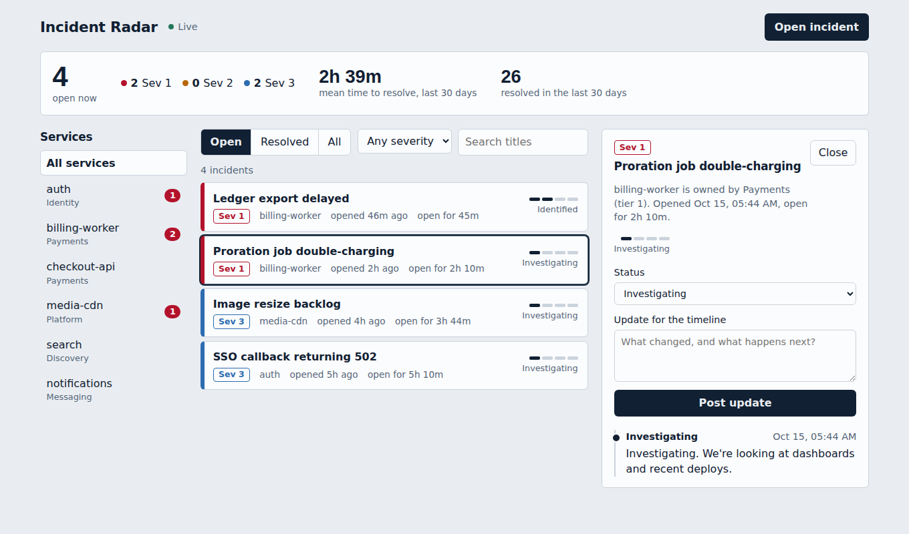

# Incident Radar

A live dashboard for tracking service incidents: open one, post status updates, and watch changes from other people appear without refreshing. Python (FastAPI + Strawberry GraphQL) on the back end, React + TypeScript on the front end, with types generated from the GraphQL schema.



## Why it's built this way

The point of the project is the API design, so each feature exists to exercise a real GraphQL concern:

| Concern | How it's handled | Where |
| --- | --- | --- |
| **N+1 queries** | Per-request `DataLoader`s batch service, update, and open-count lookups. A test asserts the SQL statement count stays constant as rows grow. | `backend/app/loaders.py`, `tests/test_schema.py` |
| **Pagination** | Relay-style cursor connections using keyset pagination on `(created_at, id)`: stable when rows are inserted, no `OFFSET` scans. | `Query.incidents` |
| **Expected errors** | Mutations return a union (`IncidentType \| UserError`) so validation failures are typed data the UI narrows by `__typename`, not stringly-typed exceptions. | `IncidentPayload` |
| **Real-time** | A `incidentChanged` subscription over `graphql-ws`; the client refetches visible queries when it fires. | `Subscription`, `frontend/src/App.tsx` |
| **End-to-end types** | The backend exports `schema.graphql`; `graphql-codegen` generates typed documents. Break the schema and `tsc` fails, not production. | `frontend/codegen.ts` |
| **Query safety** | Depth limit, page-size clamp, and IDs/cursors validated at the boundary. | `schema.py` |
| **Business rules** | Resolving stamps `resolved_at`; a resolved incident rejects further updates. | `Mutation.post_update` |

## Run it

Requires Python 3.11+ and Node 20+.

```bash
make install        # venv + pip install, npm install
make api            # http://localhost:8000/graphql  (GraphiQL playground)
make web            # http://localhost:5173          (in a second terminal)
```

The API creates a SQLite database and seeds 42 demo incidents on first start. Open the app in two browser windows, post an update in one, and watch the other change.

```bash
make test           # 8 backend tests
cd frontend && npm run build   # codegen + strict typecheck + production build
```

## Layout

```
backend/app/
  schema.py    GraphQL types, queries, mutations, subscription
  loaders.py   DataLoaders (batching)
  models.py    SQLAlchemy 2.0 models
  pubsub.py    in-process event fan-out for subscriptions
  seed.py      deterministic demo data
frontend/src/
  operations.ts   every GraphQL document, typed by codegen
  client.ts       urql client: HTTP + WebSocket
  components/     list, detail, stats, dialogs
schema.graphql    exported SDL (CI fails if it drifts from the code)
```

## Trade-offs and what I'd do next

- **Subscriptions are in-process.** Fine for one worker; with several, `PubSub` would sit on Redis pub/sub behind the same interface.
- **SQLite for zero-setup.** The models and async session are Postgres-ready; switch `DATABASE_URL` to `postgresql+asyncpg://...` and add Alembic migrations.
- **No auth.** Next steps would be a session or JWT in the GraphQL context, with per-field permissions (Strawberry permission classes).
- **Cache strategy is urql's document cache plus a refresh key.** A normalized cache (`@urql/exchange-graphcache`) would avoid refetching whole pages after a single change.
- **Persisted queries** would let production reject anything not shipped with the client.
